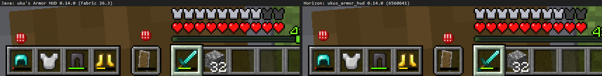
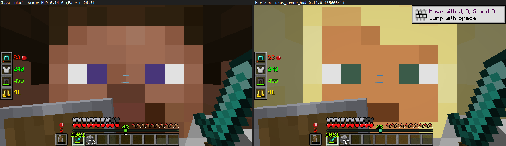
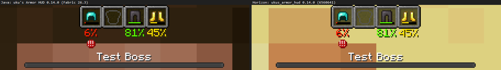
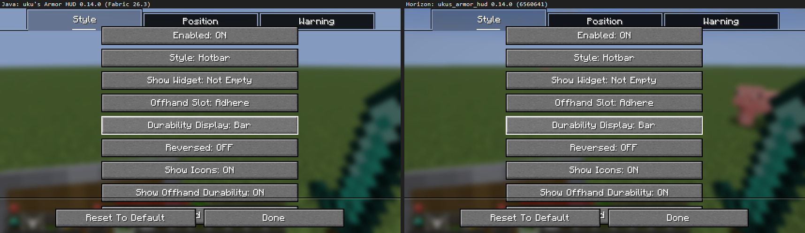
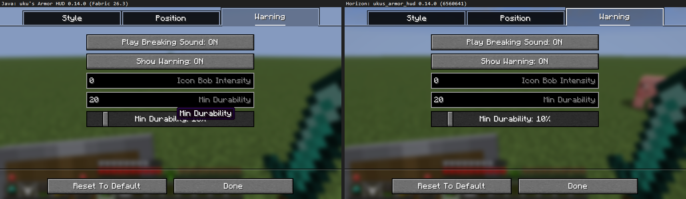

# uku's Armor HUD for Horizon

A Horizon (Minecraft 26.3 in Rust) native mod: a port of
[uku's Armor HUD](https://modrinth.com/mod/ukus-armor-hud) 0.14.0+mc26.3
([uku3lig/armor-hud](https://github.com/uku3lig/armor-hud), MIT, Copyright (c) 2021 BerdinskiyBear, fork by uku).

A minimalist, vanilla-like widget beside the hotbar with your armour, its durability bars, and a warning
icon (plus a breaking sound) when a piece runs low. Everything of the original is reproduced with its own
numbers: anchors (Hotbar, Top, Top Center, Vertical Center, Bottom), sides, X/Y offsets, the four slot
styles (Hotbar, Rounded Corners, Rounded, None), horizontal and vertical layouts, when the widget shows
(Always, If Any Present, Not Empty, Damaged Pieces), the off-hand slot and attack indicator behaviour,
durability as bar, number or percentage, off-hand and main-hand durability, reversed order, the empty
slot icons, the warning thresholds and bob, pushing boss bars, effect icons and subtitles out of the way,
the toggle key and the tabbed config screen.

## Original vs. port

Same scene, same window (854×480) and GUI scale 2; left the Java mod (Fabric 26.3), right this port.
Apart from the warning icon's random bob and the 3D world behind, they match pixel for pixel
(`tools/compare.sh`, `tools/pixdiff.ps1`).

## Use

- **Options > Mods > uku's Armor HUD**: the mod's switch, its keys (Toggle Armor Hud, Open Config
  Screen; both unbound like the original's toggle) and a page with every cycling option.
- The config screen (Style, Position, Warning tabs, as ukulib draws it) opens in a world with the
  "Open Config Screen" key, or from the settings page's first button once you are back in the game.
- Settings are kept in `horizon-mods/.horizon-mod-data/ukus_armor_hud/`, one file per option, named as
  the original config's fields.

## Compatibility

Built on Horizon's numbered hook points (`"hooks": 411`), so it builds on later Nightlies without a pin.
One small internal module (`peek.rs`) reads the local player's armour, hands, selected slot, main arm,
attack indicator, an item's durability and the sound volume, which the hook API doesn't offer yet; see
its header for the exact fields.

## Build

`py -3 tools/package.py` writes `target/ukus_armor_hud-0.14.0.hnmod` (source only; the launcher compiles
it). `tools/rebuild.ps1` is the local compile loop against a Nightly worktree.
